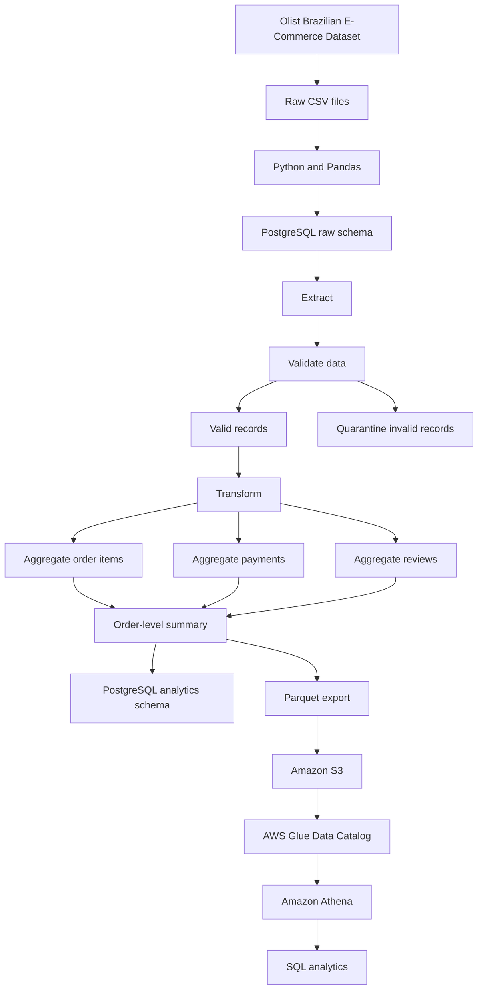
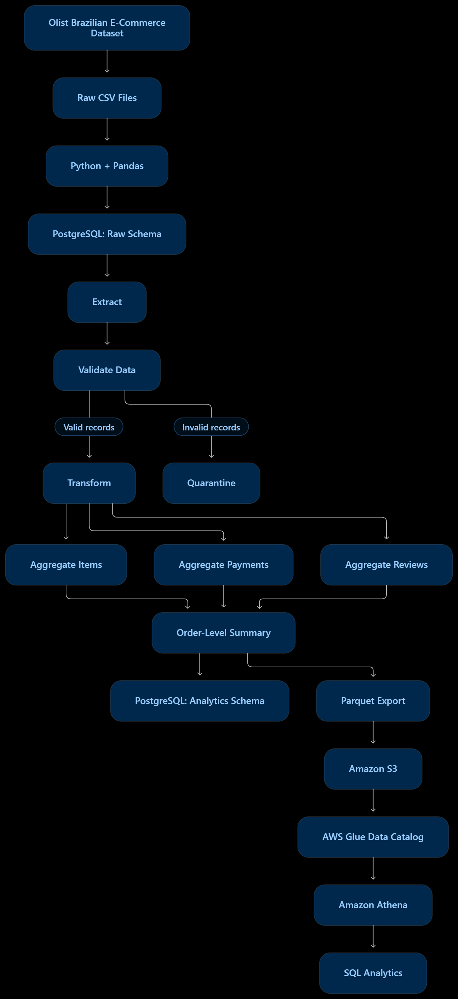

# RetailFlow - E-commerce Data Pipeline

RetailFlow is a batch ETL learning project built around the Brazilian
E-Commerce Public Dataset by Olist. It extracts CSV data into PostgreSQL,
validates and quarantines records, builds an order-level analytical table,
and exports that table to Parquet for optional AWS analytics.

## Technology

Python, Pandas, SQLAlchemy, PostgreSQL, PyArrow/Parquet, Amazon S3, AWS Glue,
and Amazon Athena.

## Data flow

1. `python src/load_raw.py` loads the seven required CSVs from `data/raw/`
   into the PostgreSQL `raw` schema. The command fails before loading if a
   required file is absent.
2. `python src/main.py` extracts orders, customers, order items, payments,
   reviews, and product IDs; validates records; transforms the valid data;
   and writes the outputs.
3. Valid order-level results go to `analytics.order_summary` and
   `data/processed/order_summary.parquet`. Invalid rows, including rejected
   customer records, are written to `data/quarantine/`.

The order summary has one row per order. Items, payments, and reviews are
aggregated independently before joining, which prevents one-to-many joins
from inflating financial totals. Product IDs are extracted for order-item
referential-integrity checks; product-level analytical output is not yet
implemented.

## Architecture



## Project evidence

The following screenshots document local pipeline execution and testing,
PostgreSQL data-quality investigation, and the AWS S3/Athena workflow. They
are evidence from the captured runs and do not imply that the pipeline is
scheduled or deployed automatically.

### ETL execution

The captured terminal output shows 99,441 orders extracted and a
99,441 × 14 analytical dataset generated. This screenshot ends during the
loading stage, before the final completion message; it does not independently
confirm that the run completed successfully.


### Automated testing

All 19 tests passed in the captured run.


### PostgreSQL quality report

The report highlights orders without item rows by status, including 603
unavailable and 164 cancelled orders. These anomalies are retained for
investigation rather than interpreted as ordinary sales.


### Amazon S3 upload

The S3 console shows the uploaded `order_summary.parquet` object in the
processed data location.


### Amazon Athena results

The Athena query completed successfully and returned order counts by status,
demonstrating that the cataloged cloud data can be queried.


### Architecture diagram image

The architecture is also available as a static image:



### Validation behavior

- Every row sharing a duplicate `order_id` is quarantined.
- Every row sharing a duplicate `(order_id, order_item_id)` key is
  quarantined. Multiple item rows for one order are valid; only a repeated
  composite key is treated as duplicate.
- Missing order-item and product IDs, unknown product references, duplicate
  review IDs, invalid prices/freight, and invalid review scores are
  quarantined with reasons.
- Customer rows with missing IDs are quarantined. Duplicate customer IDs are
  also quarantined as a group. Customer totals, valid/rejected counts,
  missing-ID counts, and duplicate-ID counts are logged.
- Negative payment values are retained because the source does not establish
  whether they represent refunds or another transaction type. Interpret
  payments in context before treating them as sales.

## Setup

Use Python 3.11 or later and install PostgreSQL. Download the Olist CSV
dataset from [Kaggle](https://www.kaggle.com/datasets/olistbr/brazilian-ecommerce)
and place the required files in `data/raw/`:

- `olist_orders_dataset.csv`
- `olist_customers_dataset.csv`
- `olist_order_items_dataset.csv`
- `olist_order_payments_dataset.csv`
- `olist_order_reviews_dataset.csv`
- `olist_products_dataset.csv`
- `product_category_name_translation.csv`

Create and activate a virtual environment, then install dependencies:

```powershell
python -m venv .venv
.\.venv\Scripts\Activate.ps1
pip install -r requirements.txt
```

Create a PostgreSQL database named `retailflow` (or configure another name)
and create a root `.env` file:

```text
PG_HOST=localhost
PG_PORT=5432
PG_DATABASE=retailflow
PG_USER=postgres
PG_PASSWORD=your_password
```

Do not commit `.env` or real credentials. Run these commands from the project
root; the supported entry points are scripts, not `python -m src.main`:

```powershell
python src/load_raw.py
python src/main.py
python src/verify_output.py
python -m pytest -v
```

## Outputs and SQL

- `analytics.order_summary`: PostgreSQL order-level table.
- `data/processed/order_summary.parquet`: Parquet output with financial
  columns represented as `decimal(12,2)`.
- `data/quarantine/*_invalid.csv`: rejected records and validation reasons.
- `logs/retailflow.log`: pipeline messages, customer quality metrics, and
  failures.
- `sql/data_quality_report.sql`: order-level quality checks.
- `sql/analytics_queries.sql`: monthly order volume, payment averages by
  status, and repeat-customer purchasing examples.

The payment-based analytical queries report **recorded payments**, not
recognized revenue. Payments associated with cancelled or unavailable
orders must not automatically be reported as sales.

## Key engineering decisions.

- Pre-aggregate one-to-many tables before joining to avoid financial fanout.
- Preserve orders without payment or item records using LEFT JOINs.
- Use Decimal for financial precision.
- Quarantine invalid records instead of silently deleting them.
- Use Parquet decimal types for downstream analytics.

## Current limitations

- Analytics loading is a full refresh: `analytics.order_summary` is replaced
  on each run.
- Parquet is written before PostgreSQL is replaced, so a failure between
  those steps can leave the outputs out of sync.
- Product/category enrichment, incremental processing, scheduled
  orchestration, and automated AWS upload/catalog registration are not
  implemented.
- Payment/refund semantics and financial reconciliation need further
  business validation.
- The dataset is licensed CC BY-NC-SA 4.0; follow the source dataset's
  attribution and usage terms.
